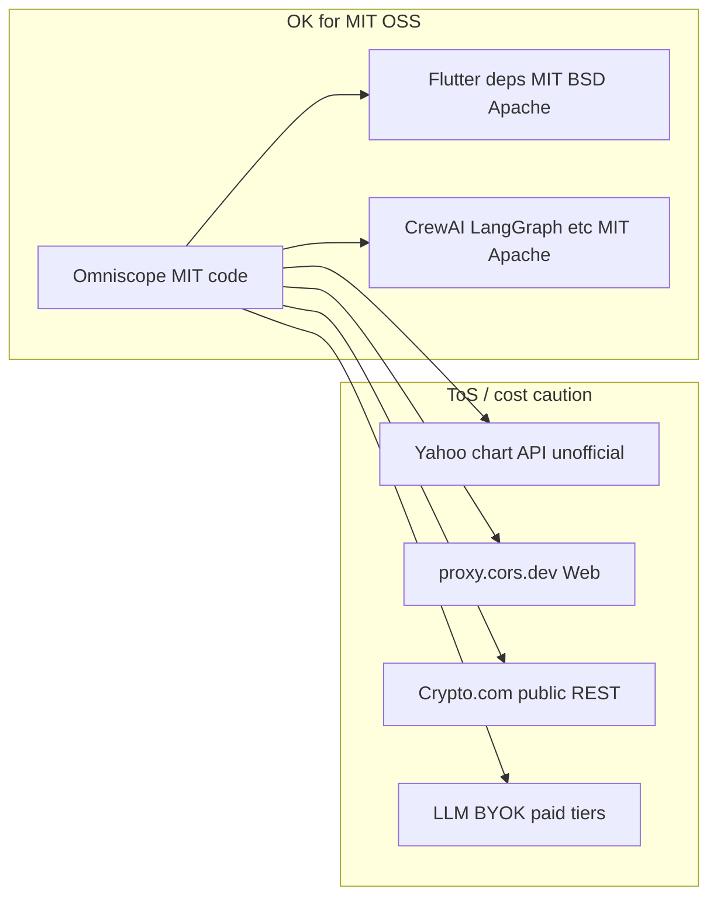

# License & free-API audit

**Verdict:** Shipping Omniscope **source code under MIT is fine** with the current dependency set. Nothing in Flutter or the agents `pyproject.toml` requires a paid package license or copyleft that conflicts with MIT.

What is **not** “free / freely redistributable as a product” is **market data and some runtime services**, mainly Yahoo Finance. That is a **ToS / commercial-use** issue, not an MIT packaging issue. The README already frames this as educational/personal POC.

---

## 1. Package licenses — OK

| Layer | Finding |
|-------|---------|
| Repo | [LICENSE](LICENSE) — MIT |
| Flutter (`pubspec.lock`, ~104 pkgs) | MIT / BSD-3 / Apache-2.0 only. **No GPL, AGPL, Commons Clause, or paid dual-license.** |
| [shadcn_ui](pubspec.yaml) | **MIT** (Flutter port). Bundles **Geist** fonts under **SIL OFL 1.1** (compatible if you keep OFL notices; do not sell fonts alone). |
| Agents ([agents/pyproject.toml](agents/pyproject.toml)) | Direct deps MIT/Apache/BSD: `crewai`, `langgraph`, `langchain-*`, `yfinance` (Apache), `pandas` (BSD), `pandas-ta` (MIT), `edgartools` (MIT), `feedparser` (BSD). |

**Attribution hygiene (not blockers):** preserve BSD/Apache notices on distribution; document Geist OFL (+ Lucide ISC via icons) e.g. `THIRD_PARTY_NOTICES` or Flutter’s licenses page. Optional: lock agents deps and run `pip-licenses` before bundling a Python env.

---

## 2. APIs / services — where “free” is shaky

| Service | Used where | Free at HTTP layer? | MIT code OK? | Product / ToS risk |
|---------|------------|---------------------|--------------|--------------------|
| **Yahoo Finance** `query1…/v8/finance/chart` | [yahoo_market_data_client.dart](lib/data/market/yahoo_market_data_client.dart); CLI via `yfinance` | Keyless, unofficial | Yes (code) | **Highest.** Yahoo ToS restrict automated collection without permission and commercial reuse / substitute apps. README already: educational only; check terms before commercial use. |
| **proxy.cors.dev** | Web Yahoo path only | Public free proxy | Yes | Third-party; rate/policy/uptime not yours; not a production CORS strategy. |
| **Crypto.com** public REST | [crypto_com_exchange_client.dart](lib/data/crypto/crypto_com/crypto_com_exchange_client.dart) | Keyless tickers/candles | Yes | Exchange API terms; private portfolio/orders need user keys. Fine for POC; review before commercial redistribution of quotes. |
| **LLM providers** (OpenAI, Anthropic, Gemini, DeepSeek, Grok) | [llm_chat_client.dart](lib/data/agents/llm_chat_client.dart), [llm.py](agents/omniscope_agents/llm.py) | BYOK; usage usually paid | Yes | Agents need **user-paid** keys; not a license conflict. Core Markets/Portfolio work without LLMs. |
| **SEC EDGAR** (via `edgartools`) | Declared for hedge-fund CLI | Free public data | Yes | Fair-access (User-Agent, rate limits). Implementation modules appear incomplete in-tree — low current exposure. |
| Outbound links (Wikipedia, Google Finance, TradingView) | [market_data_links.dart](lib/data/market/market_data_links.dart) | N/A | Yes | Links only — OK. |

**Not a problem for MIT:** using paid APIs behind **user-owned keys** (Crypto.com private, LLMs). That does not make the repo non-MIT or “not free software.”

---

## 3. What you do *not* need to change for MIT compliance

- No need to drop `shadcn_ui`, CrewAI, LangGraph, or Flutter plugins for license reasons.
- No need to relicense the project.
- LLMs and optional exchange credentials staying BYOK is the right model for an MIT educational app.

---

## 4. Optional hardening (only if you want tighter compliance)

If you want to reduce ToS / commercial risk (not required just to keep MIT):

1. Keep Yahoo framed as **educational / personal** (already in [README.md](README.md)); strengthen About copy to match “check third-party terms before commercial use.”
2. For any commercial fork: replace Yahoo with a **licensed** market-data provider; drop hard dependency on `proxy.cors.dev` for Web (own proxy or provider with CORS).
3. Add `THIRD_PARTY_NOTICES` for OFL Geist + standard OSS notices.
4. Lock agents deps + `pip-licenses` report before shipping a bundled Python environment.

No code changes proposed in this audit unless you ask to implement one of those hardenings.
