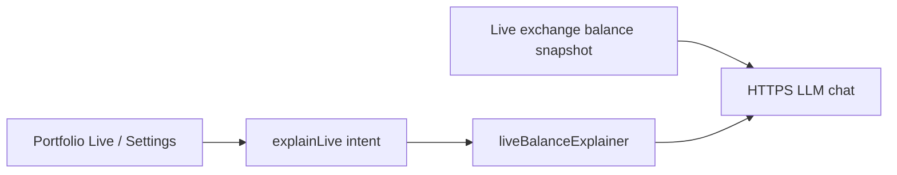

# Recommended next agent persona

## What you have today

Three roles in [`agents/omniscope_agents/manifest.json`](agents/omniscope_agents/manifest.json):

| Role | Job |
|------|-----|
| Market Research & Analysis | Symbol briefs |
| Intraday Execution & Risk Control | Live trade size / risk + order JSON |
| Hedge Fund Desk | Multi-stage desk + live trade JSON |

Launch intents ([`lib/data/agents/agent_launch.dart`](lib/data/agents/agent_launch.dart)) are only `investigate` and `tradeCheck`. Context injection is **per-symbol** (plus live balances for trading roles only during a trade Run). Agents do not yet explain portfolio-level state on the Portfolio tab.

Omniscope supports Markets/Crypto browsing, a Practice portfolio, and **live** exchange balances / confirmed orders when credentials are set. Agents should serve that full surface — not treat practice as the only journey.

## Biggest gap

Roles today are **symbol-centric**: research a ticker, or propose a live trade. Missing:

- Plain-language help on **live balances** (total vs available, asset vs cash, read-only vs Confirm path) — already called out in [`AGENTS.md`](AGENTS.md) as an open CTA candidate
- Portfolio-level questions (allocation, concentration, cash drag) across Practice and Live subgroups
- Crypto-pair / markets-instrument literacy without forcing a full research or trade Run

## Recommendation: add **Live Balance Explainer** first

| Field | Value |
|-------|--------|
| **id** | `liveBalanceExplainer` |
| **title** | Live Balance Explainer |
| **workload** | `investigation` (no trade JSON) |
| **framework** | CrewAI / light models |
| **job** | Explain live exchange snapshot in plain language — totals, available cash, per-asset balances, what is read-only vs what Confirm / Autopilot would touch |

**Why this over others:** Live portfolios are a first-class product surface; the explainer is already named in the agents roadmap; trading roles already can inject live balance context but only during trade Runs — Portfolio Live tiles and Settings → Portfolios still have no agent path.

**Minimal product wiring (when you choose to build it):**

1. Register role in `manifest.json` + system/run prompts in [`agent_role_prompts.dart`](lib/data/agents/agent_role_prompts.dart).
2. Add launch intent `explainLive` (do not overload `tradeCheck` or `investigate`).
3. Reuse / extend live exchange context from [`market_context_builder.dart`](lib/data/agents/market_context_builder.dart) for venue-level Runs (symbol optional).
4. CTAs: Portfolio **Live** summary and balance tiles; Settings → Portfolios live cards.

## Other strong personas (later)

Ranked for product fit; all investigation / no live order JSON unless noted:

1. **Portfolio & Allocation Guide** (`portfolioGuide`) — multi-holding diversification / cash drag on Practice **and** Live summaries.
2. **Practice Portfolio Coach** (`paperPortfolioCoach`) — review practice cash, holdings, proposed size, avg cost on the Practice subgroup (still useful; not the product’s sole framing).
3. **Crypto Spot Primer** (`cryptoSpotGuide`) — Crypto hub / `BTC_USD`-style pairs literacy.
4. **Markets & Instruments Tutor** (`marketsLiteracy`) — indices vs ETFs vs stocks; empty / overview-missing asset detail.
5. **Risk & Sizing Basics** (`riskBasics`) — position % / downside without competing with Intraday’s live proposals.
6. **Connections & Setup Tutor** (`setupTutor`) — LLM keys, exchange creds, Practice vs Live setup (activation).

**Deprioritize for v0:** tax agent, news/macro-only agent, equities broker desk (live orders are crypto-first today).

## Suggested decision

Ship **Live Balance Explainer** as the next role. Add Portfolio & Allocation Guide (and optionally Practice Portfolio Coach) once portfolio-wide context injection exists — they share similar plumbing.
