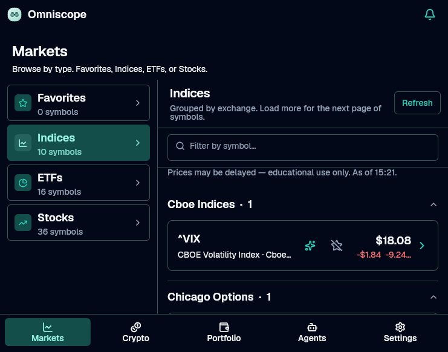

# Omniscope

Omniscope is a Flutter app for **learning investing and managing personal finance**.  
v0 is a no-accounts proof of concept: browse markets simply, inspect a price chart, and practice with a local paper portfolio.

Targets: **Linux**, **Windows**, **Android**, **Apple** (**iOS** / **macOS**), and **Web**. Every change must stay compatible across all of them.



## Features (v0)

- **Markets** — Favorites (one shared list), Indices, ETFs, Stocks, and enabled crypto exchanges (Spot pairs); star any symbol to save favorites
- **Asset detail** — price, day change, short curated overview (default symbols), 1M / 3M / 1Y history chart, paper buy/sell, plus external research links opened in the system browser
- **Portfolio** — practice paper trading (default $10,000 starting cash, configurable in Settings, local holdings, P&L, reset) plus **Live** balance subgroups when API credentials are configured (Crypto.com, Alpaca, …)
- **Agents** — connect AI helpers with your own API key and model, then chat on-device via in-process Genkit agents (tools + Run); trading roles can Confirm into Practice or a live exchange. Keys and chat threads stay local.
- **Settings** — appearance, data sources & credentials, practice cash, connections, data & privacy, and About
- **No accounts** — everything stays on device in one `omniscope.json` config (Web: browser storage + import/export)

## Quick start

```bash
cd /path/to/omniscope
make get
make run                 # DEVICE=linux by default; also: chrome / windows / android / ios / macos
make check               # analyze + test
```

Full toolchain setup (Flutter, Linux/Android deps, hooks): [`docs/development.md`](docs/development.md).

## Documentation

| Doc | For |
|-----|-----|
| [`AGENTS.md`](AGENTS.md) | Coding agents and contributors — stack, contracts, UX rules, commands |
| [`docs/development.md`](docs/development.md) | Flutter, toolchains, `make run`, pre-commit hooks |
| [`docs/build-and-release.md`](docs/build-and-release.md) | Release builds, CI workflows, tagging |
| [`docs/container.md`](docs/container.md) | Podman image, GHCR |
| [`docs/architecture.md`](docs/architecture.md) | `lib/` layout, market-data overview, icons/splash |
| [`CONTRIBUTING.md`](CONTRIBUTING.md) | How to open a PR |

Shared editor guidance also lives under [`.agents/skills/`](.agents/skills/) (Flutter / Dart / Genkit skills). Cursor-only rules: [`.cursor/rules/`](.cursor/rules/). Refresh skills with `make agent-skills`.

## Market data

Equities / indices use **Yahoo Finance** (keyless, unofficial). Crypto quotes use **Crypto.com Exchange** public REST first; brokers such as **Alpaca** power Live portfolio and agent orders, not Markets quotes. Optional credentials: [`.env`](.env.example) or **Settings → Data sources → Credentials**.

- Data may be delayed; endpoints can change or rate-limit without notice.
- For **educational / personal** use in this POC only. Check Yahoo’s, Crypto.com’s, and Alpaca’s terms before redistribution or commercial use.
- Web CORS, routing, and how to add providers: [`docs/architecture.md`](docs/architecture.md) and [`AGENTS.md`](AGENTS.md).

## Contributing

See [CONTRIBUTING.md](CONTRIBUTING.md). Please follow the [Code of Conduct](CODE_OF_CONDUCT.md).  
Security reports: [SECURITY.md](SECURITY.md).

## License / disclaimer

Released under the [MIT License](LICENSE).

**Use at your own risk.** Omniscope is an educational proof of concept, not a brokerage or financial-advice product. Nothing in the app (quotes, charts, paper trades, agent chat, or CLI pipelines) is investment, legal, or tax advice. You are solely responsible for any decisions you make. Authors and contributors accept no liability for losses, damages, or data issues arising from use of this software, market data, or third-party APIs.

Not financial advice. Paper trading is simulated. Market data ownership remains with the originating exchanges and Yahoo Finance. API keys and secrets stay on your device — protect them accordingly.
