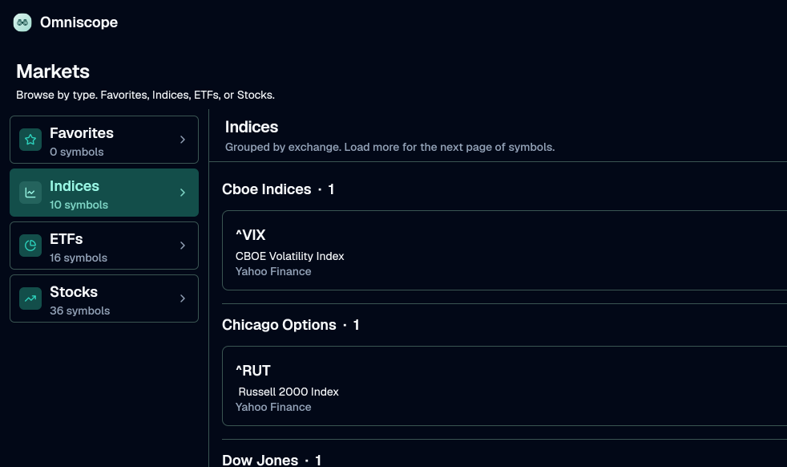

# Omniscope

Omniscope is a Flutter app for **learning investing and managing personal finance**.  
v0 is a no-accounts proof of concept: browse markets simply, inspect a price chart, and practice with a local paper portfolio.

Targets: **Linux**, **Windows**, **Android**, **Apple** (**iOS** / **macOS**), and **Web**. Every change must stay compatible across all of them.



## Features (v0)

- **Markets** — Favorites, Indices, ETFs, and Stocks as separate subgroups; each lists live quotes by exchange (star symbols to save favorites)
- **Crypto** — exchange group (Crypto.com subgroup today); each exchange has Favorites + Spot pairs from public APIs
- **Asset detail** — price, day change, short curated overview (default symbols), 1M / 3M / 1Y history chart, paper buy/sell, plus external research links (provider page, Wikipedia when mapped, Google Finance, TradingView) opened in the system browser
- **Portfolio** — practice paper trading (default $10,000 starting cash, configurable in Settings, local holdings, P&L, reset) plus **Live** exchange balance subgroups when API credentials are configured (e.g. Crypto.com)
- **Agents** — connect AI helpers with your own API key and model, then chat on-device (freeform + symbol Run); keys and chat threads stay local. Python CrewAI/LangGraph CLIs remain available under `agents/`
- **Settings** — sidebar section navigator (one pane at a time): appearance, data sources & credentials, practice starting cash, connections (LLM keys + agents/exchanges), data & privacy (path / import / export / clear local data), and About (tagline *My trusted learning and trading buddy* + educational disclaimer)
- **No accounts** — everything stays on device in one `omniscope.json` config (Web: browser storage + import/export)

## Market data

Equities / indices use **Yahoo Finance** chart endpoints (keyless, unofficial). Crypto uses a swappable [`CryptoExchangeClient`](lib/data/crypto/crypto_exchange_client.dart) registry; **Crypto.com Exchange** public REST is registered first (`get-tickers` / `get-candlestick` at `https://api.crypto.com/exchange/v1/`). Optional Crypto.com API key/secret/token can be set in [`.env`](.env.example) or under **Settings → Crypto exchanges** (dual sync: UI suggests `.env` values and writes the unified config + `.env` when possible); key+secret also enable live balances on the Portfolio tab via `private/user-balance`. Both are reached through [`RoutingMarketDataClient`](lib/data/market/routing_market_data_client.dart) implementing [`MarketDataClient`](lib/data/market/market_data_client.dart). **Settings → Data sources** lets you enable or disable each equities provider and crypto venue (persisted in the config file; new sources default to on). Appearance prefs (theme, list density, compact prices, default Asset detail chart range) live under **Settings → Appearance**. Secrets, favorites, portfolio, agents, and chats share one **`omniscope.json`** (default: app support directory via `path_provider`; desktop can set a custom path under **Settings → Data & privacy**; Web uses browser storage with Import/Export).

- Data may be delayed; endpoints can change or rate-limit without notice.
- **Web:** Yahoo’s chart host does not send CORS headers, so Chrome blocks direct `query1.finance.yahoo.com` calls. Equities requests on Web go through a public GET proxy (`https://proxy.cors.dev/…`) inside [`YahooMarketDataClient`](lib/data/market/yahoo_market_data_client.dart); native targets call Yahoo directly. Crypto.com public REST already allows browser origins.
- For **educational / personal** use in this POC only. Check Yahoo’s and Crypto.com’s terms before redistribution or commercial use.
- To add another equities provider: implement `MarketDataClient` and pass it as `equities:` to the router in [`lib/main.dart`](lib/main.dart).
- To add another crypto exchange: implement `CryptoExchangeClient`, then append it to `CryptoExchangeRegistry` in `main.dart` (new Crypto subgroup appears automatically).

## Prerequisites

### Flutter

This machine can use a local SDK at `~/flutter` (stable). Add it to your PATH:

```bash
export PATH="$HOME/flutter/bin:$PATH"
flutter doctor
```

### Linux desktop

Install build tools (Fedora example):

```bash
sudo dnf install -y clang cmake ninja-build gtk3-devel pkgconf-pkg-config \
  xz-libs libstdc++-devel mesa-libEGL-devel
```

Then `flutter doctor` until the Linux toolchain is green.

### Android

Install Android Studio / SDK, accept licenses, and connect a device or emulator.  
The `android/` tree is generated; Internet permission is already declared for market requests.

## Run

Prefer the root [`Makefile`](Makefile) (`make help` lists targets). On Windows, use Git Bash or WSL (same as `tool/*.sh`).

```bash
cd /path/to/omniscope
make get
make run                 # DEVICE=linux by default
make run DEVICE=chrome   # or: windows / android / ios / macos
```

Analyze / test:

```bash
make check               # analyze + test (same as pre-push)
# equivalents: make analyze | make test
# or: tool/flutter_checks.sh all
```

### Release builds

Flutter does **not** cross-compile every desktop/iOS binary from one machine. Prefer per-platform targets, or `make build` for whatever the current host can produce:

```bash
make build               # Linux → linux+apk+web; macOS → macos+ios+apk+web; Windows → windows+apk+web
make build-linux         # flutter build linux --release
make build-windows       # Windows host
make build-macos         # macOS host
make build-ios           # macOS; unsigned (--no-codesign)
make build-apk           # Android APK (needs Android SDK)
make build-appbundle     # Android AAB for Play Store
make build-web
```

| Artifact | Target | Host needed |
|----------|--------|-------------|
| Linux desktop | `build-linux` | Linux + GTK toolchain |
| Windows desktop | `build-windows` | Windows |
| macOS desktop | `build-macos` | macOS + Xcode |
| iOS (unsigned `.app`) | `build-ios` | macOS + Xcode |
| Android APK / AAB | `build-apk` / `build-appbundle` | any + Android SDK |
| Web | `build-web` | any |

Artifacts land under `build/` (e.g. Linux `build/linux/x64/release/bundle/`, APK `build/app/outputs/flutter-apk/app-release.apk`, Web `build/web/`).

Underlying Flutter commands still work: `flutter pub get`, `flutter run -d linux`, `flutter analyze`, `flutter test`.

### Pre-commit / pre-push hooks

This repo uses [`pre-commit`](https://pre-commit.com/) to block bad commits and pushes:

| When | Checks |
|------|--------|
| **commit** | merge conflicts, private keys, [gitleaks](https://github.com/gitleaks/gitleaks) secret scan, basic file hygiene |
| **push** | gitleaks again, `flutter analyze`, `flutter test` |

Install once after clone (needs `pre-commit` on your PATH):

```bash
make hooks
make hooks-run           # optional: verify the whole tree
# or: pre-commit install --hook-type pre-commit --hook-type pre-push
#     pre-commit run --all-files
```

Hooks look for Flutter via `PATH`, `FLUTTER_ROOT`, or `~/flutter/bin`.

## Architecture

```text
lib/
  main.dart                 # DI: router + crypto registry + portfolio + agents
  app.dart                  # ShadApp theme shell
  core/                     # formatting + brand colors
  data/market/              # MarketDataClient, Yahoo, routing
  data/crypto/              # CryptoExchangeClient + Crypto.com adapter
  data/portfolio/           # local paper portfolio (shared_preferences)
  data/agents/              # connections, chat threads, LlmChatClient, catalog
  features/markets|crypto|asset_detail|portfolio|agents|shell/
  widgets/                  # chart + brand mark
agents/                     # Python CrewAI + LangGraph CLI agents
assets/brand/               # master app icon (source of truth for launchers)
assets/agents/              # llm_models.json (selectable models)
```

UI uses **[`shadcn_ui`](https://pub.dev/packages/shadcn_ui)** only (`ShadApp`). Charts are drawn with `CustomPaint` so no second UI kit is required.

Non-UI packages: `http`, `shared_preferences`, `intl`, `provider`.

### App icon

Master art lives in [`assets/brand/app_icon.png`](assets/brand/app_icon.png) (adaptive foreground: [`app_icon_foreground.png`](assets/brand/app_icon_foreground.png)). After editing the masters, regenerate every platform icon:

```bash
make icons
# or: tool/regen_icons.sh
```

That runs [`flutter_launcher_icons`](https://pub.dev/packages/flutter_launcher_icons) (Android / iOS / macOS / Web / Windows from [`pubspec.yaml`](pubspec.yaml)) and refreshes Linux window icons under [`linux/runner/resources/`](linux/runner/resources/).

Selectable LLM models live in [`assets/agents/llm_models.json`](assets/agents/llm_models.json) so the list can be refreshed later without changing Flutter UI code. Optional local secrets: copy [`.env.example`](.env.example) → `.env` (gitignored) for LLM provider keys and exchange credentials (e.g. Crypto.com). The UI suggests those values and saves edits back to `.env` when running from a desktop checkout (prefs cover every platform). Agent role → framework rules and layout are in [`AGENTS.md`](AGENTS.md).

## Docs for agents

See [`AGENTS.md`](AGENTS.md) for conventions when extending Omniscope (UI rules, provider swaps, portfolio contract, AI agent roles).

## Contributing

See [CONTRIBUTING.md](CONTRIBUTING.md). Please follow the [Code of Conduct](CODE_OF_CONDUCT.md).
Security reports: [SECURITY.md](SECURITY.md).

## License / disclaimer

Released under the [MIT License](LICENSE).

**Use at your own risk.** Omniscope is an educational proof of concept, not a brokerage or financial-advice product. Nothing in the app (quotes, charts, paper trades, agent chat, or CLI pipelines) is investment, legal, or tax advice. You are solely responsible for any decisions you make. Authors and contributors accept no liability for losses, damages, or data issues arising from use of this software, market data, or third-party APIs.

Not financial advice. Paper trading is simulated. Market data ownership remains with the originating exchanges and Yahoo Finance. API keys and secrets stay on your device — protect them accordingly.
